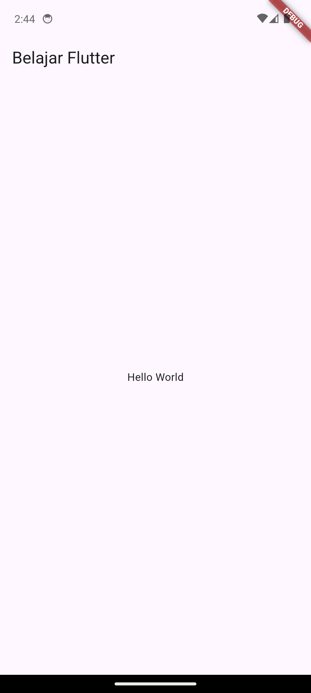

# Pertemuan 1

Introduction to Android and Flutter: Pengenalan Android dan Flutter, persiapan lingkungan pengembangan, serta aplikasi pertama.

## Tujuan Pembelajaran

Setelah mempelajari materi ini, mahasiswa diharapkan mampu:

1. Menjelaskan pengertian Flutter dan bahasa pemrograman Dart.
2. Memahami gambaran umum perbedaan Android Native dan Flutter.
3. Mengenali perangkat lunak yang diperlukan untuk pengembangan aplikasi Flutter.
4. Membuat project Flutter baru.
5. Menjalankan aplikasi menggunakan emulator Android atau perangkat Android fisik.
6. Mengenali struktur folder project Flutter.
7. Membuat aplikasi sederhana yang menampilkan teks **Hello World**.

## Pengenalan Flutter

Flutter adalah framework open-source yang dikembangkan oleh Google untuk membangun aplikasi dari satu basis kode (*single codebase*). Materi perkuliahan memperkenalkan Flutter untuk pengembangan aplikasi Android, iOS, web, dan desktop.

### Flutter dan Dart

- **Flutter:** framework dan toolkit untuk membangun antarmuka serta aplikasi.
- **Dart:** bahasa pemrograman yang digunakan untuk menulis kode aplikasi Flutter.
- **Widget:** komponen penyusun antarmuka aplikasi, misalnya teks, gambar, tombol, dan tata letak.

Gambaran sederhananya:

```text
Kode Dart
   ↓
Framework Flutter dan widget
   ↓
Aplikasi yang dijalankan pada perangkat target
```

### Android Native dan Flutter

| Aspek | Android Native | Flutter |
|---|---|---|
| Bahasa yang disebut dalam materi | Java atau Kotlin | Dart |
| Target utama dalam penjelasan materi | Android | Android dan iOS; materi juga mengenalkan web dan desktop |
| Pendekatan | Pengembangan untuk platform Android | Satu basis kode untuk beberapa target platform |

**Catatan:** tabel ini merangkum pengenalan pada bahan kuliah, bukan perbandingan lengkap seluruh teknologi pengembangan aplikasi.

### Gambaran Arsitektur Flutter

Alur konseptual pada materi:

1. Pengembang menulis kode menggunakan Dart.
2. Flutter menyediakan framework dan widget untuk membangun antarmuka.
3. Project dikompilasi dan dijalankan pada perangkat target.

Contoh susunan widget yang ditunjukkan dalam materi adalah `Column` yang menampung beberapa widget, seperti `Image`, `Text`, dan `Button`.

### Keunggulan yang Diperkenalkan dalam Materi

- **Pengembangan lintas platform:** satu basis kode dapat digunakan untuk beberapa platform yang didukung.
- **Widget untuk UI:** antarmuka disusun dari komponen-komponen.
- **Kompilasi dan produktivitas:** materi menekankan kompilasi cepat dan produktivitas pengembangan.
- **Hot Reload:** perubahan kode dapat terlihat dengan cepat tanpa harus mengulang seluruh proses dari awal dalam banyak kasus.

## 3. Perangkat Pengembangan

Materi praktikum memperkenalkan perangkat berikut.

| Perangkat | Fungsi |
|---|---|
| **Git** | Sistem version control untuk mengelola perubahan kode |
| **JDK** | Java Development Kit; perangkat pengembangan Java yang menjadi bagian dari kebutuhan lingkungan Android pada konfigurasi tertentu |
| **Flutter SDK** | Menyediakan perintah dan perangkat pengembangan Flutter |
| **Android Studio** | IDE Android, termasuk pengelolaan Android SDK dan emulator |
| **Visual Studio Code (VS Code)** | Editor kode yang dapat digunakan untuk mengembangkan aplikasi Flutter |
| **Flutter extension** | Integrasi Flutter di VS Code atau Android Studio |
| **Dart extension** | Dukungan bahasa Dart pada editor |
| **Android Emulator / AVD** | Perangkat Android virtual untuk menjalankan dan menguji aplikasi |
| **HP Android** | Perangkat fisik untuk menjalankan dan menguji aplikasi |

### 3.1 Catatan tentang Versi Perangkat Lunak

Modul praktikum dibuat dengan contoh versi yang lebih lama, termasuk JDK 15 dan tampilan IDE pada saat modul disusun. Untuk instalasi saat ini, periksa kebutuhan versi Flutter dan Android SDK yang berlaku. Jangan menganggap semua nomor versi atau tampilan menu di modul lama masih sama.

## Menyiapkan Lingkungan Pengembangan

### Instalasi Git

1. Buka <https://git-scm.com/downloads>.
2. Unduh Git sesuai sistem operasi.
3. Jalankan installer dan ikuti petunjuk instalasi.

### Instalasi JDK

Modul menjelaskan JDK sebagai perangkat untuk pengembangan Java. Pada contoh di modul, JDK diunduh dari <https://jdk.java.net/> dan folder `bin` ditambahkan ke variabel lingkungan `Path`.

Untuk memeriksa Java melalui terminal atau Command Prompt:

```bash
java -version
javac -version
```

### Instalasi Android Studio

1. Buka <https://developer.android.com/studio>.
2. Unduh dan instal Android Studio.
3. Ikuti proses konfigurasi awal.
4. Pastikan koneksi internet tersedia saat komponen SDK perlu diunduh.
5. Android Studio dapat digunakan untuk mengelola Android SDK dan membuat emulator.

### Instalasi Flutter SDK

1. Buka dokumentasi instalasi Flutter: <https://docs.flutter.dev/get-started/install>.
2. Pilih sistem operasi yang digunakan.
3. Unduh Flutter SDK sesuai petunjuk resmi.
4. Ekstrak SDK ke folder yang mudah ditemukan, misalnya `D:\Android\flutter` pada contoh Windows di modul.
5. Tambahkan folder `bin` Flutter ke `Path`, misalnya:

```text
D:\Android\flutter\bin
```

6. Buka terminal baru, kemudian periksa instalasi:

```bash
flutter --version
flutter doctor
```

`flutter doctor` membantu memeriksa kesiapan lingkungan pengembangan dan menunjukkan komponen yang masih perlu dikonfigurasi.

### Konfigurasi VS Code

1. Unduh VS Code dari <https://code.visualstudio.com/download>.
2. Instal extension **Flutter** dan **Dart**.
3. Buka terminal dan jalankan `flutter doctor` untuk memeriksa konfigurasi.

---

## Membuat Project Flutter

Project dapat dibuat melalui Android Studio atau VS Code.

### Melalui Android Studio

Secara garis besar, langkah pada modul:

1. Jalankan Android Studio.
2. Pilih **Create New Flutter Project**.
3. Pilih **Flutter Application**.
4. Isi nama project, lokasi Flutter SDK, lokasi project, dan deskripsi.
5. Selesaikan proses pembuatan project.

Contoh pada modul:

- **Project name:** `belajarflutter`
- **Flutter SDK path:** `D:\Android\flutter`
- **Project location:** `D:\Belajar`
- **Description:** `Membuat Aplikasi Mobile Flutter`

Nama folder dan lokasi di atas hanya contoh.

### Melalui VS Code

1. Buka VS Code.
2. Tekan `Ctrl + Shift + P` untuk membuka Command Palette.
3. Ketik dan pilih **Flutter: New Project**.
4. Pilih **Application**.
5. Tentukan folder penyimpanan.
6. Masukkan nama project, misalnya `aplikasi_flutter_pertamaku`.
7. Tunggu sampai project selesai dibuat.

Alternatif melalui terminal:

```bash
flutter create aplikasi_flutter_pertamaku
cd aplikasi_flutter_pertamaku
code .
```

---

## Menjalankan Aplikasi

Flutter dapat dijalankan melalui emulator Android atau HP Android fisik.

### Menggunakan Emulator Android

1. Buka pengelola perangkat virtual Android di Android Studio.
2. Pilih **Create Virtual Device**.
3. Pilih profil perangkat.
4. Pilih atau unduh system image Android yang diperlukan.
5. Selesaikan konfigurasi dan jalankan emulator.
6. Pilih emulator tersebut sebagai target perangkat.
7. Jalankan aplikasi dari IDE.

Nama menu dan tata letaknya dapat berbeda antarversi Android Studio.

### Menggunakan HP Android Fisik

Modul praktikum menyarankan perangkat Android fisik sebagai alternatif emulator.

1. Buka **Settings** pada HP.
2. Masuk ke **About Phone** atau menu sejenis.
3. Ketuk **Build Number** beberapa kali untuk mengaktifkan Developer Options. Pada beberapa merek, lokasi atau nama menunya berbeda.
4. Buka **Developer Options**.
5. Aktifkan **USB Debugging**.
6. Hubungkan HP ke komputer menggunakan kabel USB yang mendukung transfer data.
7. Setujui permintaan otorisasi debugging pada HP jika muncul.
8. Periksa apakah perangkat terdeteksi:

```bash
flutter devices
```

9. Jalankan aplikasi ke perangkat yang terdeteksi.

**Catatan keamanan:** aktifkan USB Debugging hanya pada perangkat dan komputer yang Anda percaya. Matikan kembali jika sudah tidak diperlukan.

### Memilih Target Perangkat

| Pilihan | Kelebihan | Hal yang perlu diperhatikan |
|---|---|---|
| Emulator | Dapat menguji profil perangkat dan konfigurasi Android virtual | Membutuhkan sumber daya komputer lebih besar |
| HP Android | Menguji aplikasi pada perangkat fisik dan biasanya lebih ringan bagi komputer | Memerlukan kabel data, otorisasi USB, dan pengaturan Developer Options |

---

## Struktur Folder Project Flutter

Berikut folder dan file yang diperkenalkan dalam modul.

| Folder/File | Fungsi |
|---|---|
| `android/` | Berisi bagian project khusus Android |
| `ios/` | Berisi bagian project khusus iOS |
| `lib/` | Tempat utama kode Dart aplikasi ditulis |
| `test/` | Tempat kode pengujian aplikasi |
| `.gitignore` | Menentukan file atau folder yang diabaikan Git |
| `.metadata` | Metadata project yang dibuat oleh Flutter |
| `pubspec.yaml` | Informasi project serta dependensi/package yang dibutuhkan |
| `pubspec.lock` | Mengunci versi dependensi yang terselesaikan |
| `README.md` | Dokumentasi ringkas project |

Modul juga menyebut `.packages` dan file `.iml` pada struktur project contoh. File yang dihasilkan dapat berbeda bergantung pada versi Flutter dan tooling; tidak semua file lama selalu muncul pada project baru.

### File yang Perlu Dikenali Terlebih Dahulu

- **`lib/main.dart`** — titik awal kode aplikasi pada contoh praktikum.
- **`pubspec.yaml`** — konfigurasi project dan dependensi.
- **`android/`** — konfigurasi dan kode platform Android.
- **`test/`** — pengujian otomatis.

---

## Membuat Aplikasi Hello World

Praktikum berakhir dengan aplikasi sederhana yang menampilkan AppBar bertuliskan **Belajar Flutter** dan teks **Hello World** di tengah layar.

Buka `lib/main.dart`, lalu gunakan contoh kode berikut:

```dart
import 'package:flutter/material.dart';

void main() {
  runApp(const MyApp());
}

class MyApp extends StatelessWidget {
  const MyApp({super.key});

  @override
  Widget build(BuildContext context) {
    return MaterialApp(
      title: 'Aplikasi Flutter Pertama',
      home: Scaffold(
        appBar: AppBar(
          title: const Text('Belajar Flutter'),
        ),
        body: const Center(
          child: Text('Hello World'),
        ),
      ),
    );
  }
}
```

> Catatan: contoh di atas menggunakan bentuk constructor `const MyApp({super.key})` yang lebih ringkas dan setara untuk tujuan praktikum dengan pola constructor yang ditampilkan pada modul.

### Penjelasan Kode

| Bagian | Fungsi |
|---|---|
| `import 'package:flutter/material.dart';` | Mengimpor komponen Material Design dari Flutter |
| `void main()` | Fungsi utama yang dijalankan pertama kali |
| `runApp(const MyApp())` | Menjalankan widget utama aplikasi |
| `class MyApp extends StatelessWidget` | Membuat widget yang tidak menyimpan state yang berubah |
| `build(BuildContext context)` | Menyusun widget yang akan ditampilkan |
| `MaterialApp` | Membungkus aplikasi dengan konfigurasi Material |
| `Scaffold` | Menyediakan struktur halaman, seperti AppBar dan body |
| `AppBar` | Bagian bilah atas halaman |
| `Center` | Menempatkan child di tengah area yang tersedia |
| `Text` | Menampilkan teks |

### Hierarki Widget

Struktur widget pada contoh dapat dibaca sebagai berikut:

```text
MyApp
└── MaterialApp
    └── Scaffold
        ├── AppBar
        │   └── Text("Belajar Flutter")
        └── Center
            └── Text("Hello World")
```

Flutter menyusun tampilan dari widget yang saling bersarang. `Scaffold` menjadi kerangka halaman, sedangkan `AppBar` dan `body` merupakan bagian dari halaman tersebut.

### Menjalankan dan Memeriksa Hasil

1. Pastikan emulator aktif atau HP Android sudah terhubung.
2. Pilih perangkat target.
3. Jalankan project.
4. Pastikan layar menampilkan:
   - AppBar dengan judul **Belajar Flutter**
   - Tulisan **Hello World** di tengah layar

---

## Istilah Penting

| Istilah | Arti ringkas |
|---|---|
| Flutter | Framework untuk membangun aplikasi lintas platform |
| Dart | Bahasa pemrograman Flutter |
| SDK | Kumpulan alat dan library untuk pengembangan |
| IDE | Lingkungan pengembangan terintegrasi |
| Widget | Komponen pembentuk antarmuka Flutter |
| `MaterialApp` | Widget tingkat aplikasi untuk konfigurasi Material |
| `Scaffold` | Kerangka dasar halaman |
| AVD | Android Virtual Device, konfigurasi perangkat virtual |
| Emulator | Perangkat lunak yang meniru lingkungan perangkat |
| Hot Reload | Memperbarui perubahan kode ke aplikasi yang berjalan dengan cepat |
| `pubspec.yaml` | File konfigurasi project dan dependensi |
| USB Debugging | Fitur untuk debugging perangkat Android melalui USB |

---

## Ringkasan Pertemuan 1

1. Flutter merupakan framework open-source dari Google untuk membangun aplikasi dari satu basis kode.
2. Dart adalah bahasa pemrograman yang digunakan dalam Flutter.
3. Widget adalah komponen utama untuk menyusun antarmuka aplikasi.
4. Pengembangan membutuhkan Flutter SDK dan perangkat pendukung seperti Git, editor/IDE, serta Android SDK sesuai kebutuhan.
5. Aplikasi dapat dijalankan pada emulator Android atau HP Android fisik.
6. Kode aplikasi utama pada praktikum ditulis di `lib/main.dart`.
7. `MaterialApp`, `Scaffold`, `AppBar`, `Center`, dan `Text` merupakan widget dasar yang digunakan pada contoh.
8. Hasil praktikum adalah aplikasi dengan judul **Belajar Flutter** dan teks **Hello World**.

## Checklist Praktikum

- [ ] Memeriksa instalasi Git.
- [ ] Menginstal dan mengonfigurasi Flutter SDK.
- [ ] Menginstal VS Code serta extension Flutter dan Dart.
- [ ] Menjalankan `flutter doctor`.
- [ ] Memastikan emulator atau HP terdeteksi melalui `flutter devices`.
- [ ] Membuat project Flutter baru.
- [ ] Membuka `lib/main.dart`.
- [ ] Menjalankan aplikasi Hello World.
- [ ] Mengambil screenshot hasil aplikasi untuk dokumentasi praktikum.

## Latihan Mandiri

1. Jelaskan perbedaan Flutter dan Dart dengan bahasa sendiri.
2. Sebutkan minimal lima widget atau komponen yang digunakan dalam contoh aplikasi.
3. Apa fungsi folder `lib/` dan file `pubspec.yaml`?
4. Apa perbedaan menjalankan aplikasi menggunakan emulator dan HP Android fisik?
5. Ubah teks `Hello World` menjadi nama Anda atau teks lain, kemudian jalankan ulang aplikasi.
6. Ubah judul AppBar dari `Belajar Flutter` menjadi `Praktikum Pertemuan 1`.

## Sumber Materi

1. **Pertemuan 01 — Introduction to Android and Flutter**, Azlan Irwan, M.Kom.
2. **Modul Praktikum Pemrograman Mobile**, Azlan Irwan, M.Kom.
3. Dokumentasi resmi Flutter: <https://docs.flutter.dev/>
4. Dokumentasi Android Studio: <https://developer.android.com/studio>
5. Dokumentasi VS Code: <https://code.visualstudio.com/docs>

---

## File Latihan

| File | Keterangan |
|---|---|
| [hello_world/main.dart](hello_world/main.dart) | Aplikasi Hello World: AppBar "Belajar Flutter" + teks "Hello World" di tengah layar |

Kode di atas adalah `lib/main.dart` yang dipakai pada praktikum, persis dari
materi dosen. Letakkan di dalam project Flutter sebagai `lib/main.dart`,
lalu jalankan dengan emulator atau HP Android.

## Lingkungan yang Terpakai

Pemeriksaan lingkungan pengembangan pada mesin ini:

| Komponen | Versi / Lokasi |
|---|---|
| Flutter SDK | `~/Appz/flutter` (dipasang untuk praktikum ini) |
| Android Studio | `~/Appz/android-studio` |
| Android SDK | `~/Appz/Sdk` — platform android-29 s/d 37.2 |
| build-tools | 36.0.0, 37.0.0 |
| platform-tools | adb 1.0.41 |
| Emulator | `~/Appz/Sdk/emulator` |
| JDK | OpenJDK 21.0.12 |

Catatan: modul praktikum dibuat dengan contoh versi lama (JDK 15). Versi di
atas adalah yang berlaku saat praktikum dikerjakan, dan sudah memenuhi
kebutuhan Flutter serta Android SDK yang berlaku.

## Hasil Praktikum

Aplikasi Hello World **benar-benar dibuat dan dijalankan**, bukan hanya kode
contoh. Lingkungan yang dipakai:

| Komponen | Versi |
|---|---|
| Flutter SDK | 3.35.1 (channel stable) |
| Dart | 3.9.0 |
| JDK | OpenJDK 21.0.12 |
| Android SDK | platform android-34, build-tools 37.0.0 |
| Perangkat | Emulator Pixel 6, Android 14 (API 34) |

### Screenshot Hasil



Tampilan sesuai tujuan pembelajaran: AppBar bertuliskan **Belajar Flutter**
dan teks **Hello World** di tengah layar. Banner **DEBUG** pada sudut adalah
tanda aplikasi berjalan dalam mode debug (bawaan `flutter run`).

### Langkah yang Dilakukan

1. Memasang Flutter SDK 3.35.1 ke `~/Appz/flutter`
2. Memeriksa lingkungan dengan `flutter doctor`
3. Membuat system image Android 34 dan emulator (AVD) `praktikum_p1`
4. Membuat project dengan `flutter create --org ac.id.unsia belajar_flutter`
5. Menuliskan kode Hello World di `lib/main.dart`
6. Build APK debug: `flutter build apk --debug`
7. Install ke emulator dan menjalankan aplikasi

### Catatan Lingkungan

- **Izin KVM:** emulator perlu akses `/dev/kvm`. User `mhs0075` sudah
  ditambahkan ke grup `kvm`; pada sesi lama, gunakan `sg kvm -c "<perintah>"`
  agar izin berlaku tanpa logout.
- **Versi JDK:** Android Studio membawa JDK 25, sedangkan Gradle 8.12 yang
  dipakai Flutter 3.35.1 belum mendukungnya. Build dilakukan dengan
  **OpenJDK 21** melalui `org.gradle.java.home` di `android/gradle.properties`.
- Modul praktikum dibuat dengan contoh versi lama (JDK 15, Windows).
  Versi di atas adalah yang berlaku saat praktikum dikerjakan.
